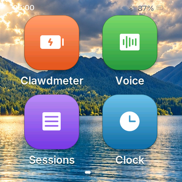
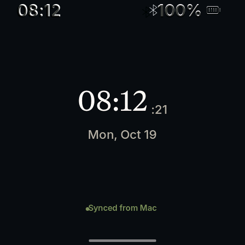
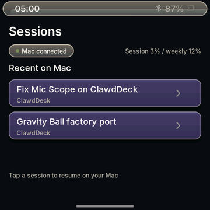
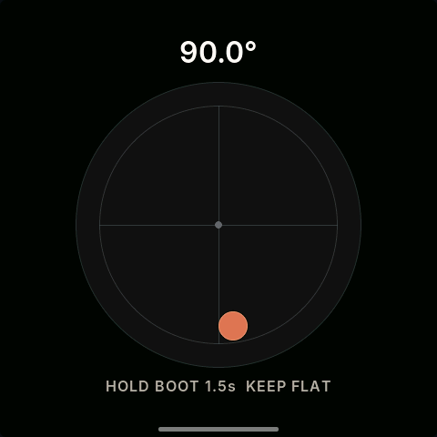
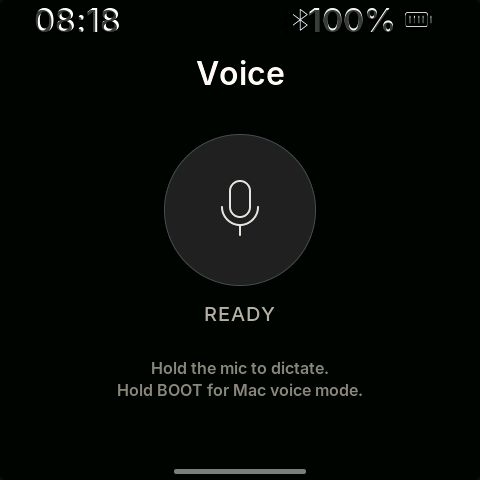
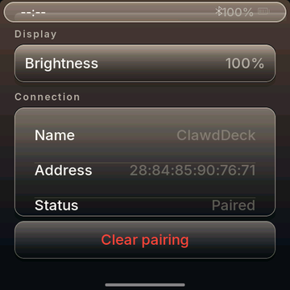
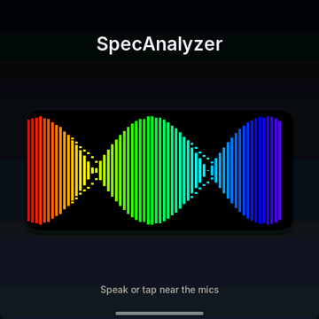
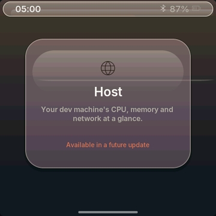

# ClawdDeck


A desk-side ESP32 command deck: a pocket dashboard that keeps an eye on
Claude Code usage — and runs a full Apple-grade app suite on its
480×480 square AMOLED.

ClawdDeck grew out of **[Clawdmeter](https://github.com/HermannBjorgvin/Clawdmeter)** —
the Claude Code usage meter that is still the heart of the deck (its meter app
is the launcher's first tile).
ClawdDeck = Clawdmeter + the phone-style launcher it deserved.

<a href="https://buymeacoffee.com/growingcatb"></a>

|  Home launcher  |  On hardware  |
| :---: | :---: |
|  |  |

## The apps

480×480 square AMOLED, LVGL 9, 16bpp — no GPU, no blur, everything drawn.
Every screen went through the same gauntlet: build → verify against real
reference imagery → independent blind critic → iterate until the
critic takes the candidate over the reference. The launcher runs the
factory-desktop look: a full-bleed photo wallpaper, opaque iOS-class app
icons with white filled glyphs, ghost-shadowed labels, and a bare white
status row.

|  |  |  |  |
| :---: | :---: | :---: | :---: |
|  |  |  |  |
| **Clock** — typography-first, host-synced time with seconds | **Sessions** — recent Claude sessions, tap to resume on the Mac | **Level** — gravity-following ball; centered flat and at 6 o’clock upright | **Voice** — hold to dictate; words appear as you speak ([details](#voice-dictation)) |
|  |  |  |  |
| **Settings** — brightness, pairing, device telemetry, actions (below) | **SpecAnalyzer** — live spectrum | **Host** — placeholder in the glass-card language | **Clawdmeter** — the original usage meter + splash animations |

**Settings** in detail (the address shown on the hardware screenshot is a
privacy placeholder — pair with the address a Bluetooth scan reports):

- **Display** — brightness (cycled live, NVS-backed).
- **Connection** — device name, MAC, bond status, and **Clear pairing**
  (two-tap confirm). Clearing wipes the bonds **and air-gaps the board**: it
  stops advertising and rejects new pairings until you re-arm it (hold PWR
  3 s → release). Otherwise an in-range host with stale bond keys silently
  re-pairs within ~1.5 s on macOS.
- **Device** — storage % (sketch partition), memory % (heap; PSRAM boards
  show free RAM), battery % (live, charging aware).
- **Actions** — **Close background apps (n)**, **Restart**, **Power off**.
  Restart and Power off need a second tap within 4 s.

## Quick start

You need: a supported board and a USB **data** cable, the
[PlatformIO CLI](https://docs.platformio.org/en/latest/core/installation/index.html)
(`pip install platformio`), Python 3 (3.11+ on Windows), and Claude Code
with an active subscription (`claude login` done).

**1. Get the code**

```bash
git clone https://github.com/beibeiyang/ClawdDeck.git
cd ClawdDeck
```

**2. Flash the firmware** — pick your board's env:

| Board | Env |
| --- | --- |
| [Waveshare ESP32-S3-Touch-AMOLED-2.16](https://www.waveshare.com/esp32-s3-touch-amoled-2.16.htm?&aff_id=149786) (reference board) | `waveshare_amoled_216` |
| [Waveshare ESP32-C6-Touch-AMOLED-2.16](https://www.waveshare.com/esp32-c6-touch-amoled-2.16.htm?&aff_id=149786) | `waveshare_amoled_216_c6` |
| [Waveshare ESP32-S3-Touch-AMOLED-1.8](https://www.waveshare.com/esp32-s3-touch-amoled-1.8.htm?&aff_id=149786) | `waveshare_amoled_18` |
| [Waveshare ESP32-C6-Touch-AMOLED-1.8](https://www.waveshare.com/esp32-c6-touch-amoled-1.8.htm?&aff_id=149786) | `waveshare_amoled_18_c6` |
| [Waveshare ESP32-S3-Touch-AMOLED-2.06](https://www.waveshare.com/esp32-s3-touch-amoled-2.06.htm?&aff_id=149786) | `waveshare_amoled_206` |
| [Waveshare ESP32-S3-Touch-LCD-1.54](https://www.waveshare.com/esp32-s3-lcd-1.54.htm?sku=33869&aff_id=149786) | `waveshare_lcd_154` |
| [Waveshare ESP32-S3-Touch-LCD-4](https://www.waveshare.com/esp32-s3-touch-lcd-4.htm) | `waveshare_lcd_4` |

```bash
./flash-mac.sh <env> [port]     # macOS — auto-detects /dev/cu.usbmodem*
./flash.sh <env> [port]         # Linux — defaults to /dev/ttyACM0
```

```powershell
pio run -d firmware -e <env> -t upload --upload-port COM5   # Windows — your board's COM port
```

The first flash builds everything (~1–3 min); reflashes take seconds and the
board reboots itself. A wrong chip family fails safely ("This chip is
ESP32-C6, not ESP32-S3" → use the matching env). On Linux, add yourself to
the `dialout` group first (`sudo usermod -aG dialout $USER`, then log out
and in).

**3. Pair over Bluetooth** — on boot the board advertises as **ClawdDeck**.

- **macOS** — System Settings → Bluetooth → _Connect_ next to "ClawdDeck".
- **Windows** — Settings → Bluetooth & devices → Add device → Bluetooth →
  "ClawdDeck". Pairing is required: it enables the buttons and keeps the
  connection.
- **Linux** — `bluetoothctl scan le`, then with the address it reports:
  `bluetoothctl pair <addr>` and `bluetoothctl trust <addr>`.

**4. Install the daemon** — it pushes your usage to the display every 60 s
and starts at login.

```bash
./install-mac.sh                                             # macOS
./install.sh && systemctl --user start claude-usage-daemon   # Linux
```

```powershell
powershell -ExecutionPolicy Bypass -File install-windows.ps1   # Windows (native path, not \\wsl$)
```

On macOS the installer runs the daemon in the foreground for 30 s so macOS
can ask for Bluetooth permission, then hands it to launchd. Day-to-day
commands for each platform are under [Daemon reference](#daemon-reference).

## Using the deck

The device boots into the splash. Swipe left/right to page the launcher, tap
a tile to open its app, swipe up (or tap the home pill) to go home. On the
splash, animations rotate every 20 s within the current usage-rate group.

| Button (2.16) | Function |
| --- | --- |
| **Left** — BOOT, GPIO 0 | Hold: sends Space (Claude Code voice-mode push-to-talk) |
| **Middle** — PWR, AXP2101 PKEY | On splash: next animation. **Hold 3 s + release: pairing mode** (clears the bond and re-advertises) |
| **Right** — GPIO 18 | Press: sends Shift+Tab (Claude Code mode toggle) |

Space and Shift+Tab are standard BLE HID key presses, so they reach whatever
window has focus on the paired host. Smaller boards have fewer buttons: the
1.8 and 2.06 have BOOT + PWR, and the LCD-4 has only BOOT (tap the panel to
toggle splash ↔ usage).

## Voice dictation

Hold the **mic tile** in the Voice app and talk to whatever CLI agent is
focused on your Mac — Claude Code, Codex, Cursor, aider, a plain shell. The
board streams compressed audio over BLE; the daemon transcribes it live with
[Whistle](https://cactuscompute.com/blog/whistle) (16.9 MB, CPU-only,
offline after a one-time download) and **types the words into the focused
window while you are still talking**, about a second behind your voice.
The panel shows a short live tail, then a receipt like
`Typed 22 words on your Mac`. Needs the S3 2.16 (the board with the mic) and
macOS for typing; elsewhere the transcript just appears on the panel.

**Turn it on (macOS, once):**

1. Run `./install-mac.sh` — it installs the voice dependencies and prints
   the exact `Python.app` path that needs permission.
2. Grant **Accessibility** to that `Python.app`: System Settings → Privacy &
   Security → Accessibility → **+** (⌘⇧G, paste the path) → switch it on.
   It must be Python.app, not your terminal: the daemon runs under launchd.
   Repeat after a Python upgrade replaces Python.app.
3. Add `voice_inject=on` to `~/.config/claude-usage-monitor/config`, then
   restart the daemon:
   `launchctl kickstart -k gui/$(id -u)/com.user.claude-usage-daemon`

The log line `Voice: Accessibility granted — live typing enabled` confirms
it worked. Optional settings in the same config file:

| Key | Default | Meaning |
| --- | --- | --- |
| `voice_autosubmit` | `off` | Press Enter after the text. Off = review first, then hit Enter yourself |
| `voice_engine` | `auto` | `whistle`, `whisper` (faster-whisper; transcribes only after release), or `auto` (Whistle if installed) |
| `voice_keywords` | `Claude, Claude Code, Clawdmeter` | Words to favour while decoding |
| `voice_language` | detect | `en` `de` `fr` `es` `it` `nl` `pl` |

Safety behaviour: switching apps mid-sentence pauses typing instead of
typing into the wrong window; a dropped audio packet stops typing at the gap
and the panel says so; a `" x"` typed-then-erased prefix means a misfired
Enter can never submit your dictation. Holding **BOOT** instead of the mic
tile still sends Space for Claude Code's own voice mode. The daemon disables
cactus-needle's anonymous usage pings (`NEEDLE_TELEMETRY=0`).

## Daemon reference

### macOS

Reads the OAuth token from the Keychain (service `Claude Code-credentials`).
Runs as a LaunchAgent; only one daemon can run at a time (a second copy
exits and names the running one).

```bash
tail -F ~/Library/Logs/claude-usage-daemon.out.log                           # live logs
launchctl kickstart -k gui/$(id -u)/com.user.claude-usage-daemon             # restart
launchctl unload ~/Library/LaunchAgents/com.user.claude-usage-daemon.plist   # stop
launchctl load -w ~/Library/LaunchAgents/com.user.claude-usage-daemon.plist  # start
```

The daemon only connects to the ClawdDeck this Mac is paired with; it never
scans for other boards.

### Linux

Reads the token from `~/.claude/.credentials.json`. Requires `curl`,
`bluetoothctl` and `busctl` (BlueZ).

```bash
systemctl --user status claude-usage-daemon     # status
journalctl --user -u claude-usage-daemon -f     # live logs
```

### Windows

Runs natively (no WSL) as a tray app that starts at login. Reads the token
from `%USERPROFILE%\.claude\.credentials.json` (falling back to
`%LOCALAPPDATA%\Claude\`, then `%APPDATA%\Claude\`). The installer creates a
venv from the in-repo requirements, registers an `HKCU\…\Run` autostart (no
admin), and launches the tray headlessly.

The tray icon's corner shows **green** Connected, **amber** Scanning, **red**
Error (one notification on entering Error); right-click for status, **Start
at login**, and **Quit** (pairing stays intact).

```powershell
Get-Content $env:LOCALAPPDATA\Clawdmeter\daemon.log -Tail 30                       # logs
reg delete "HKCU\Software\Microsoft\Windows\CurrentVersion\Run" /v Clawdmeter /f   # remove autostart
```

Run it in the foreground instead:

```powershell
python -m venv .venv
.venv\Scripts\Activate.ps1        # if blocked: Set-ExecutionPolicy -Scope CurrentUser RemoteSigned
pip install -r daemon\requirements-windows.txt
python daemon\claude_usage_daemon_windows.py
```

| Symptom | Fix |
| --- | --- |
| `Device not found` | Power on the device; make sure it's in range and paired. |
| `token expired` toast / `API HTTP 401` | Re-run `claude login`, then restart the daemon. |
| `Connection failed` | Toggle Windows Bluetooth off/on in Settings. |
| `Warning: running under Linux/WSL` | Run from a native PowerShell window, not a WSL shell. |

## How it works


1. The daemon reads your Claude Code OAuth token (location per platform
   above) and makes a minimal API call to `api.anthropic.com/v1/messages` —
   one token of Haiku, basically free.
2. The usage numbers come straight out of the response headers
   (`anthropic-ratelimit-unified-5h-utilization` and friends).
3. It writes them as JSON to the board's GATT RX characteristic over BLE;
   the firmware updates the LVGL dashboard.
4. The firmware tracks how fast session % changes over 5 minutes and picks
   splash animations from the matching mood group.
5. The buttons work independently of all this — they are HID key presses
   sent straight to the paired host.

### BLE protocol

The device advertises a custom GATT service alongside the standard HID
keyboard service:

| | UUID |
| --- | --- |
| **Data Service** | `4c41555a-4465-7669-6365-000000000001` |
| RX Characteristic (write) | `…0002` |
| TX Characteristic (notify) | `…0003` |
| Bridge host→device / device→host, voice chunks (notify) | `…0005` / `…0006` / `…0007` |
| **HID Service** | `00001812-0000-1000-8000-00805f9b34fb` |

Usage payload (written to RX):

```json
{ "s": 45, "sr": 120, "w": 28, "wr": 7200, "st": "allowed", "ok": true }
```

`s` = session %, `sr` = session reset (minutes), `w` = weekly %,
`wr` = weekly reset (minutes), `st` = status, `ok` = success flag.

Voice transport (for porters):

- Chunk envelope `[seq:u8][flags:u8][len:u8][payload…]`; the payload is one
  self-contained IMA-ADPCM block (`[pred:i16le][step_idx:u8][rsvd:u8]` +
  packed nibbles) sized to the negotiated MTU — at MTU 185, 350 samples
  (≈21.9 ms @ 16 kHz), 46 notifies/s.
- `flags`: bit0 end-of-utterance, bit1 8 kHz capture (small-MTU fallback),
  bit2 on EOU capture overrun. Sequence gaps and overruns are rejected with a
  retry prompt, never transcribed.
- Host → panel over the bridge: `{"t":"vp","c":<committed>,"p":<pending>}`
  while you talk (≤4 Hz, ASCII-folded, ≤160 chars), then
  `{"t":"vt","tx":…,"inj":…,"n":…,"m":…}` or `{"t":"err","m":…}`.
- Tests: `daemon/tests/test_voice_code.py` (codec, framing) and
  `daemon/tests/test_voice_whistle.py` (live path, typing edge cases).

## Development


- **Desktop simulator** — iterate on the UI without hardware: an SDL2 window
  runs the full firmware loop with scenario playback
  (`pio run -d firmware -e sim`, then `cd firmware && .pio/build/sim/program`).
  See [`SIM-USAGE.md`](SIM-USAGE.md).
- **Porting to another board** — each board is a folder under
  `firmware/src/boards/` plus a PlatformIO env; shared code never changes.
  See [`docs/porting/adding-a-board.md`](docs/porting/adding-a-board.md) and
  [`docs/porting/hal-contract.md`](docs/porting/hal-contract.md). Please check
  for an existing pull request for your hardware first — testing and QA
  feedback there beats a duplicate port.
- **Splash animations** — Anthropic's official Clawd sprites, archived with
  provenance in [`research/clawd-official/`](research/clawd-official/);
  `node tools/convert_official_clawd.js` regenerates
  `firmware/src/splash_animations.h`. See [`tools/README.md`](tools/README.md).
- **Icons** — Lucide PNGs → LVGL C arrays with `tools/png_to_lvgl.js`.
- **Fonts** — pre-compiled LVGL fonts and the LVGL 9 patching they need:
  [`docs/fonts.md`](docs/fonts.md).

## Credits

- **Tip jar** — if ClawdDeck makes your desk happier:
  [buymeacoffee.com/growingcatb](https://buymeacoffee.com/growingcatb) ☕
- **Clawdmeter** — ClawdDeck is a fork of
  [HermannBjorgvin/Clawdmeter](https://github.com/HermannBjorgvin/Clawdmeter)
  by Hermann Björgvin Haraldsson. The usage-meter concept, the BLE protocol,
  the daemon fleet, the board-port family and the splash-animation system
  all come from that project; Clawdmeter remains a first-class app inside
  ClawdDeck (the launcher's first tile). All the earlier commits in this
  repo's history are his work.
- The macOS host pieces — Python daemon, LaunchAgent and flash helper —
  were ported by [Chris Davidson (@lorddavidson)](https://github.com/lorddavidson).
- Pixel-art Clawd animations are Anthropic's official mascot art
  (claude.ai/code, Claude Code desktop), archived and converted by the
  tooling in `tools/` and `research/clawd-official/`.
- **Inter** and **Phosphor** fonts (SIL OFL / MIT) for the ClawdDeck UI type
  stack; Lucide (MIT) for the utility glyphs.
- Anthropic brand fonts (Tiempos Text, Styrene B) — see the licensing note
  below.

## Licensing gray area warning

The software in this repository uses and adheres to the Anthropic brand guidelines and uses the same proprietary fonts that Anthropic has a license for but this software uses without permission as well as using assets from Anthropic such as the copyrighted Clawd mascot so even though the code in this repo is non-proprietary I will not license it myself under a copyleft license since this repo includes proprietary fonts and copyrighted assets. Please be aware of this if you fork or copy the code from this repo. **You have been warned!**
